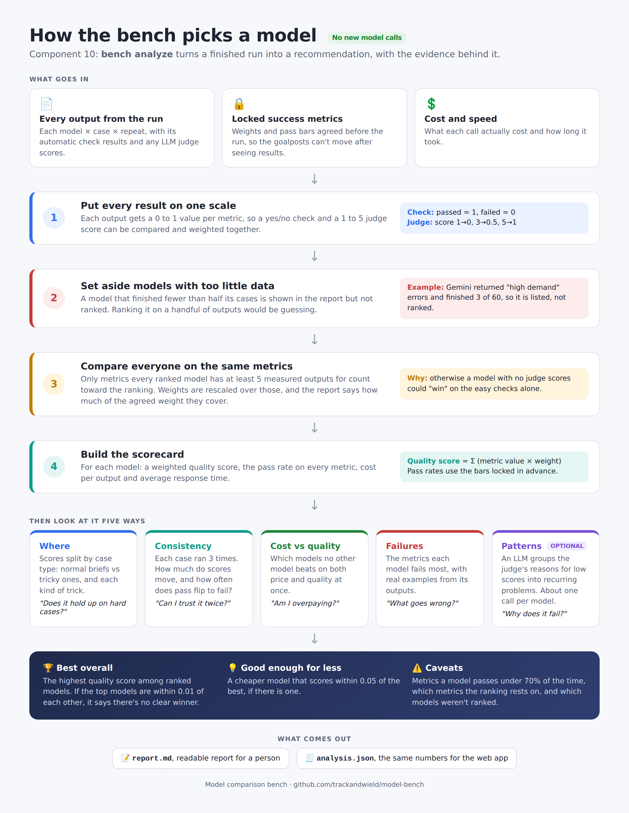

# Model Comparison Bench

Run the same marketing prompt, workflow or skill across several LLMs, score every output against success metrics locked before the run, and get a recommendation: which model to use for which task, why, and at what cost.

## The problem

Marketing teams pick an AI model by gut feel or by a public leaderboard that tests coding and math, not battlecards. Nobody on the team can say which model writes the best launch post for *their* product, where a cheaper model is good enough, or why the others fall short.

## How it works

1. **Lock the metrics first.** Each task has a `metrics.yaml` written with a working product marketer: what "good" means, how each criterion is scored (automatic check, LLM judge, human review or cost), its weight and its pass bar. `bench lock` records a hash before any model runs, so results can't be tuned after the fact.
2. **Run the matrix.** Every model × every test input × several repeats, with identical settings, logging tokens, cost and latency for every call.
3. **Score.** Rule-based checks first, then a blinded LLM judge from a different model family, calibrated against a human reviewer.
4. **Explain.** A weighted scorecard, where each model wins or loses by input type, the recurring failure patterns behind low scores, and the cost-quality trade-off.

## Status

| Milestone | State |
|---|---|
| 1. Foundations: setup, locked metrics, test set | Built; metrics awaiting PMM review |
| 2. Engine: model layer, tasks, checks, judge, runs | Model layer, task workflows, automatic checks and LLM judge built |
| 3. Human review and analysis | Analysis built; human review waits for the web app's review screen |
| 4. Web app and write-up | Web app: run builder, judging, results and side-by-side screens built |

## Run it

Needs Python 3.11+ and [uv](https://docs.astral.sh/uv/).

```bash
uv sync
cp .env.example .env              # add at least one API key
uv run python -m bench hello --mock   # no key needed: checks the wiring
uv run python -m bench hello          # calls the first model in models.yaml
uv run python -m bench hello --model openai/gpt-5-mini
uv run python -m bench compare --prompt "Write a tagline for an observability product."
uv run python -m bench compare --mock --prompt "..."   # no keys, no cost
uv run python -m bench run battlecard --limit 1   # one case on every model first
uv run python -m bench run battlecard            # all 20 cases × every model
uv run python -m bench run battlecard --repeats 3 --estimate   # cost estimate only, no calls
uv run python -m bench run battlecard --repeats 3              # the full run: 4 models × 20 cases × 3
uv run python -m bench run --resume runs/<run id>-battlecard.config.json   # finish a crashed run
uv run python -m bench check runs/<run id>-battlecard.jsonl   # re-run checks on an old run, free
uv run python -m bench judge runs/<run id>-battlecard.jsonl --estimate   # judging cost only, no calls
uv run python -m bench judge runs/<run id>-battlecard.jsonl --sample 5  # judge 5 random cards per model
uv run python -m bench judge runs/<run id>-battlecard.jsonl              # judge every card
uv run python -m bench analyze runs/<run id>-battlecard.jsonl   # scorecard, where, consistency, recommendation (free)
uv run python -m bench analyze runs/<run id>-battlecard.jsonl --patterns   # plus failure patterns (one judge call per model)
uv run python -m bench serve   # the web app at http://127.0.0.1:8000
uv run python -m bench lock battlecard
uv run python -m bench verify battlecard
uv run pytest
```

Models live in `models.yaml` as [LiteLLM](https://docs.litellm.ai/) ids, so adding or swapping one is a config change. `compare` runs every model in parallel (a few calls at a time per provider, with retries), prints tokens, cost and latency per model, and saves the outputs to `runs/<run id>.jsonl`. Every call is also logged to `runs/bench.db`, which doubles as a cache: an identical call is served from it for $0.

## Tasks

A task lives in `tasks/<task>/task.yaml`: an optional system prompt, optional reference files (a brand voice guide, say) and one or more steps. One step is a plain prompt; several make a workflow, where each step's prompt can use earlier outputs as `{{ steps.<name> }}`. The battlecard task is two steps: extract the facts from the profiles, then write the card from those facts only. `bench run` records every step's prompt and output, so you can see whether a model went wrong reading the profile or embellishing while writing. A step that errors or gets cut off at `max_tokens` stops that chain and is reported as where it broke.

## Runs

A run is every model × every case × N repeats (`--repeats`; repeats show how much a model's answers vary from one try to the next). Before any call, `bench run` prints a cost estimate: steps already in the cache are free, input tokens come from the actual prompts, and output tokens from each model's past runs (or a generous default for a model with no history). If the estimate is over the budget (`budget_usd` in `models.yaml`, or `--budget`), the run doesn't start. During the run no new call starts once the budget is spent.

Each run saves `runs/<run id>-<task>.config.json` before its first call: models, case ids, repeats, settings, hashes of the task, dataset and metrics files, whether the metrics were locked, the git commit and library versions. `--resume` reruns from that file with the same run id. Finished calls come from the cache, so after a crash, rate limit or budget stop only the missing calls are paid for. If the task, dataset or metrics changed since, it says so.

## Automatic checks

Every finished output gets rule-based checks, saved next to it in the run file, before any LLM judge sees it. The checks a task uses are listed in its `metrics.yaml`: scored `check` metrics (for battlecards: prices match the profiles, required sections present, 450 words or fewer) and unscored `diagnostics` (numbers not found in the profiles, banned marketing terms, reading grade). Each result carries its evidence, such as the invented price itself. `bench run` prints pass counts per model and check; `bench check` re-runs them on an earlier run's file without calling any model.

## LLM judge

`bench judge <run file>` scores every finished output on each `judge` metric in `metrics.yaml`, one call per output per metric, against that metric's 1 to 5 rubric. The judge replies with quoted evidence, reasoning and a score, in that order, and the scores are saved into the run file next to the checks.

Known judge biases and what the bench does about them:

- **Self-preference:** each output is judged by a model from a different provider (`judges` in `models.yaml`), so Claude never grades Claude.
- **Knowing who wrote it:** the judge never sees the model name, and vendor or model names inside the output are masked.
- **Made-up evidence:** every quote the judge gives is checked against the output; quotes that aren't there are flagged for a human.
- **Inconsistency:** `--repeat N` judges N random outputs a second time and reports how often the score matches.

Judging costs more than writing: every card gets one judge call per metric, from a stronger model. So `bench judge` estimates its cost first and holds to the same budget as runs (`budget_usd`, or `--budget`). `--sample N` judges N random cards per model, so every model has judge scores to rank on; judgments are cached, so judging the rest later only pays for the new ones.

Automatic checks can hand their flags to the judge (`show_checks`), so a number the checks couldn't find in the profiles gets a ruling: invented, or correctly worked out from the source.

## Analysis



`bench analyze <run file>` turns a run into a recommendation, and saves it as `<run>.report.md` and `<run>.analysis.json`:

- **Scorecard:** each metric's pass rate per model, and a weighted score using the locked weights. Models are ranked only on metrics every model has enough data for (a judge sample of a few cards is shown but not ranked on), and the report says which metrics the score covers.
- **Where:** score per model for each case tag (tricky vs normal, short vs long profile, each trick).
- **Consistency:** how much each model's score moves between repeats of the same case, and how often a metric passes on one repeat and fails on another.
- **Cost vs quality:** the models no other model beats on both score and cost per card, and a cheaper model that's within reach of the best.
- **Why:** the most common failures per model with evidence; `--patterns` asks a judge model to group the judge's reasons into recurring problems.

A model that finished under half its cases (say, a provider that kept refusing calls) is listed but not ranked.

## Web app

`bench serve` opens the bench in the browser, for people who'd rather not read a terminal. It reads the same run files, so anything run from the command line shows up there.

- **New run:** pick a task, how many cases, repeats and models, see the locked metrics, estimate the cost, then run. A practice run uses canned answers and costs nothing. Progress shows while it runs.
- **Saved runs:** every task run, newest first, with how many outputs finished and how many were judged.
- **Results:** judge a sample of cards per model (estimate first, same budget as runs), then the recommendation, scorecard, pass rate per metric, a heatmap of where each model is strong or weak, cost vs quality, consistency, and the most common failures with links to the cards behind them.
- **Side by side:** one case's inputs and every model's card next to each other, with each automatic check, the judge's scores and reasoning, and the numbers or phrases that failed highlighted in the card.

It's FastAPI with server-rendered pages: no Node or build step, one command to start, and it binds to this computer only unless you pass `--host`.

## Repo layout

```
bench/          the engine (CLI, model layer, metrics)
bench/web/      the web app (FastAPI, templates, CSS)
tasks/<task>/   task.yaml (prompt or workflow), metrics.yaml and its lock, cases.jsonl (tagged test inputs)
models.yaml     models under test and the settings held constant
docs/           decision log
tests/
```
